# Installation d'OpenStack 2026.1 (Gazpacho)

Déploiement d'OpenStack 2026.1 en suivant le **guide d'installation officiel**,
automatisé étape par étape avec **Vagrant + VirtualBox + Ansible (ansible_local)**.

Le sujet du lab (PDF) visait OpenStack Wallaby : ce dépôt applique les **mêmes étapes**
avec la release actuelle, **2026.1 Gazpacho** (release SLURP), sur **Ubuntu 24.04 LTS**
via l'Ubuntu Cloud Archive.

Services déployés : Keystone, Glance, Placement, Nova, Neutron (option 2 : réseaux
self-service, Open vSwitch + VXLAN), Horizon, Cinder (LVM + iSCSI).

---

## 1. Architecture

| Nœud | IP management | IP provider | vCPU / RAM | Rôle |
|---|---|---|---|---|
| `controller` | 192.168.56.11 | eth2 (sans IP) | 4 / 10 Go | MariaDB, RabbitMQ, memcached, etcd, toutes les API, agents Neutron L3/DHCP/metadata/OVS, Horizon, cinder-api/scheduler |
| `compute1` | 192.168.56.31 | eth2 (sans IP) | 4 / 8 Go | nova-compute (KVM, virtualisation imbriquée), agent OVS |
| `block1` | 192.168.56.41 | – | 2 / 2 Go | cinder-volume, LVM (`cinder-volumes` sur un disque dédié de 20 Go), tgt (iSCSI) |

Réseaux VirtualBox :

| Interface | Type | Réseau | Usage |
|---|---|---|---|
| eth0 | NAT (Vagrant) | 10.0.2.0/24 | Internet, SSH Vagrant |
| eth1 | host-only | 192.168.56.0/24 | **management** (trafic entre services, tunnels VXLAN, iSCSI) |
| eth2 | host-only, promiscuous `allow-all` | 192.168.57.0/24 | **provider** : interface sans IP, branchée sur le bridge OVS `br-provider` |

Réseaux OpenStack créés pendant le lab :

- `provider` : réseau flat externe sur 192.168.57.0/24 (IP flottantes) ;
- `selfservice` : réseau VXLAN projet 172.16.1.0/24, routé vers `provider` par le routeur `router`.

---

## 2. Prérequis sur le poste Windows

- VirtualBox et Vagrant (testé avec **Vagrant 2.4.9**), environ 20 Go de RAM libres.
- La box `bento/ubuntu-24.04` (amd64).
- **L'hyperviseur Windows désactivé pendant le TP** (voir §2.1).
- Une variable d'environnement contenant le mot de passe Ansible Vault, dans la session PowerShell :

  ```powershell
  $env:TP_OS_VAULT_PASS = Read-Host "Mot de passe Vault"
  ```

  Le Vagrantfile la lit et la dépose dans `/etc/ansible-vault-pass.txt` (mode 0640, root:vagrant),
  **en dehors** du dossier synchronisé `/vagrant`. Sans cette variable, le provisioner
  `vault-pass` s'arrête en erreur.

### Poste hôte utilisé

| Mémoire | Processeur |
|---|---|
| 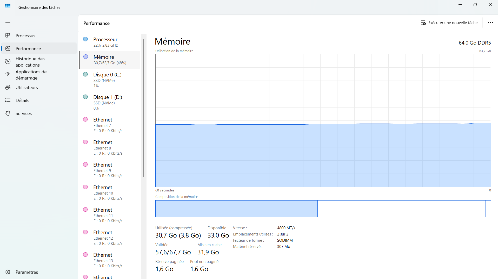 | 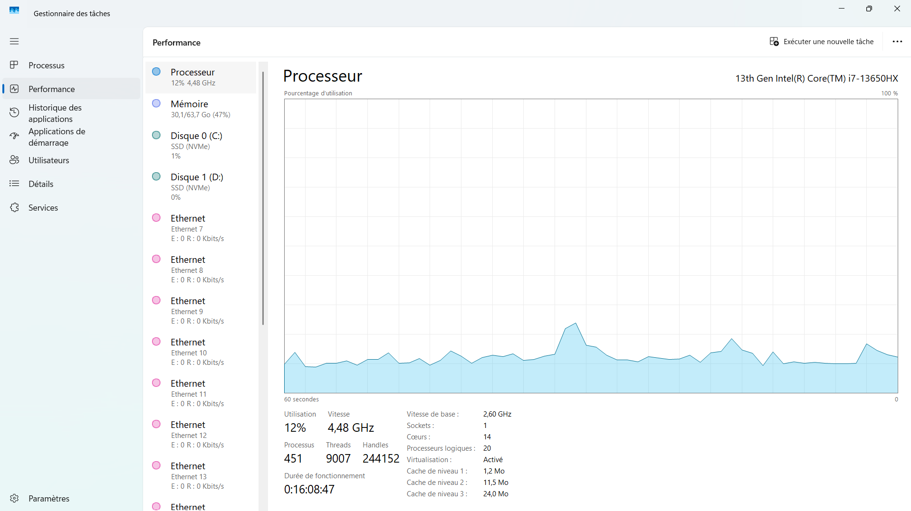 |

- **Mémoire** : 64 Go de DDR5, avec environ 30 Go déjà occupés hors du lab au moment de la capture.
  Les 3 VM demandent 20 Go au total (10 + 8 + 2 Go), donc la marge reste confortable.
- **Processeur** : Intel Core i7-13650HX (14 cœurs, 20 processeurs logiques), avec
  **Virtualisation : Activé**. VT-x est donc bien activé dans le firmware. C'est une condition
  nécessaire, mais pas suffisante, pour que VirtualBox l'utilise (voir §2.1).

### 2.1 Hyperviseur Windows (Hyper-V / VBS) : à désactiver, puis à réactiver

Quand l'hyperviseur Windows est actif, VirtualBox fonctionne en mode **NEM** (API Hyper-V).
Ce mode a été constaté dans `VBox.log` : `HMR3Init: fall back to NEM: VT-x is not available`.
Les VM sont alors très lentes, et compute1 n'a pas de virtualisation imbriquée, donc pas de KVM.

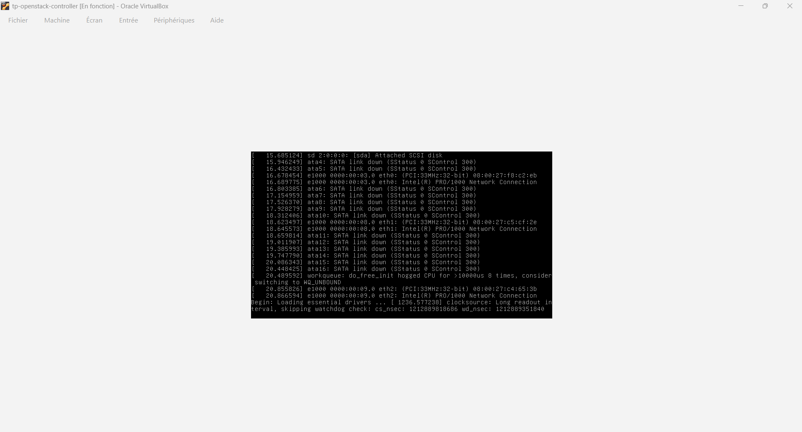

*Démarrage du controller avec l'hyperviseur Windows actif.* Le noyau est encore à l'étape
`Begin: Loading essential drivers ...` alors que l'horodatage noyau a sauté de ~20 s à
**1236 s**, avec `clocksource: Long readout interval, skipping watchdog check`. Le démarrage
dure donc plus de 20 minutes au lieu de quelques secondes, ce qui provoquait les timeouts de
`vagrant up`. Le symptôme a disparu après la désactivation ci-dessous.

Désactivation temporaire (PowerShell **administrateur**, puis redémarrage) :

```powershell
bcdedit /export D:\bcd-backup.bcd
bcdedit /set "{current}" hypervisorlaunchtype off
```

Après redémarrage, on constate VBS = 0 et VT-x utilisé par VirtualBox, et `/dev/kvm` existe sur compute1.

> **À la fin du LAB**, pour retrouver WSL2 / Docker Desktop / VBS :
>
> ```powershell
> bcdedit /set "{current}" hypervisorlaunchtype auto
> ```
>
> puis redémarrer Windows. La sauvegarde du magasin BCD reste disponible dans `D:\bcd-backup.bcd`.

---

## 3. Arborescence

```
tp-openstack/
├── Vagrantfile
├── README.md
├── tests-de-validation.md
├── docs/captures/             # captures d'écran citées dans les deux fichiers .md
└── ansible/
    ├── site.yml                    # 5 plays : all, infra controller, services controller, computes, storages
    ├── group_vars/all/
    │   ├── main.yml                # variables non sensibles (aucun secret en clair)
    │   └── vault.yml               # secrets chiffrés (ansible-vault), NON fourni dans le dépôt
    └── roles/
        ├── environment             # Cloud Archive gazpacho, dist-upgrade, client OpenStack, chrony
        ├── mariadb  rabbitmq  memcached  etcd
        ├── keystone  glance  placement
        ├── nova_controller  nova_compute
        ├── neutron_controller  neutron_compute  neutron_ovs
        ├── horizon
        └── cinder_controller  cinder_storage  cinder_compute
```

Conventions : un rôle par composant du guide, joués dans l'ordre du guide. Les variables sont
externalisées dans `group_vars`, les secrets sont préfixés `vault_` dans `vault.yml`, les
handlers sont dans `handlers/main.yml`, les templates sont en Jinja2 et les options INI sont
gérées avec `community.general.ini_file`. Les tâches qui manipulent un secret portent `no_log: true`.

---

## 4. Secrets (Ansible Vault)

`ansible/group_vars/all/vault.yml` contient **15 clés** :

```
vault_rabbitmq_password       vault_keystone_db_password   vault_admin_password
vault_demo_password           vault_glance_db_password     vault_glance_password
vault_placement_db_password   vault_placement_password     vault_nova_db_password
vault_nova_password           vault_neutron_db_password    vault_neutron_password
vault_metadata_secret         vault_cinder_db_password     vault_cinder_password
```

Pour créer ou compléter le fichier dans une VM (`vagrant ssh controller`), une commande par ligne :

```bash
cd /vagrant/ansible/group_vars/all
umask 077; ansible-vault decrypt vault.yml --vault-password-file /etc/ansible-vault-pass.txt --output /tmp/v.yml
for k in vault_cinder_db_password vault_cinder_password; do grep -q "^$k:" /tmp/v.yml || echo "$k: \"$(openssl rand -hex 16)\"" >> /tmp/v.yml; done
ansible-vault encrypt /tmp/v.yml --vault-password-file /etc/ansible-vault-pass.txt --output vault.yml && shred -u /tmp/v.yml
ansible-vault view vault.yml --vault-password-file /etc/ansible-vault-pass.txt | cut -d: -f1
```

Pour un fichier neuf, il suffit de mettre les 15 noms de clés dans la boucle `for`.

---

## 5. Déploiement

Depuis `D:\tp-openstack`, dans une session PowerShell où `TP_OS_VAULT_PASS` est définie.
**L'ordre compte** : le controller héberge les bases et l'API dont dépendent les autres nœuds.

```powershell
vagrant up controller
vagrant up compute1
vagrant up block1
```

Le rôle `environment` fait un `dist-upgrade`. S'il signale `Redémarrage requis sur <nœud>` :

```powershell
vagrant reload <nœud>
```

Pour rejouer Ansible sans recréer les VM (même ordre) :

```powershell
vagrant provision controller --provision-with ansible
vagrant provision compute1   --provision-with ansible
vagrant provision block1     --provision-with ansible
```

Chaque VM ne se configure qu'elle-même : par défaut, ansible_local limite le playbook à la
machine courante. Un nouveau passage doit donner `changed=0` sur les trois nœuds (idempotence).

Accès :

- **Horizon** : http://192.168.56.11/horizon (domaine `Default`, utilisateur `admin` ou `myuser`) ;
- **CLI** : `vagrant ssh controller`, puis `source ~/admin-openrc` ou `source ~/demo-openrc`.
  Les fichiers sont aussi dans `/root`, en mode 0600.

---

## 6. Étapes manuelles du guide (après le provisioning)

Ces opérations correspondent aux pages *Verify* et *Launch an instance* du guide. Elles ont été
faites à la main en CLI, comme dans le guide, et ne sont pas dans Ansible.

### 6.1 Image CirrOS (Glance)

```bash
source ~/admin-openrc
wget http://download.cirros-cloud.net/0.4.0/cirros-0.4.0-x86_64-disk.img
openstack image create cirros --file cirros-0.4.0-x86_64-disk.img --disk-format qcow2 --container-format bare --public
```

### 6.2 Réseaux, gabarit, clé, groupe de sécurité

Les valeurs entre `< >` sont propres à chaque environnement : reporter celles utilisées.

```bash
source ~/admin-openrc
openstack network create --share --external --provider-physical-network provider --provider-network-type flat provider
openstack subnet create --network provider --allocation-pool start=<DEBUT>,end=<FIN> --dns-nameserver <DNS> --gateway <PASSERELLE> --subnet-range 192.168.57.0/24 provider
openstack flavor create --id 0 --vcpus 1 --ram 64 --disk 1 m1.nano

source ~/demo-openrc
openstack network create selfservice
openstack subnet create --network selfservice --dns-nameserver <DNS> --gateway <PASSERELLE_SELFSERVICE> --subnet-range 172.16.1.0/24 selfservice
openstack router create router
openstack router add subnet router selfservice
openstack router set router --external-gateway provider
ssh-keygen -q -N ""
openstack keypair create --public-key ~/.ssh/id_rsa.pub mykey
openstack security group rule create --proto icmp default
openstack security group rule create --proto tcp --dst-port 22 default
```

### 6.3 Instance, IP flottante, volume

```bash
source ~/demo-openrc
openstack server create --flavor m1.nano --image cirros --nic net-id=<ID_SELFSERVICE> --security-group default --key-name mykey selfservice-instance
openstack floating ip create provider
openstack server add floating ip selfservice-instance <IP_FLOTTANTE>
openstack console url show selfservice-instance
ssh -o PubkeyAcceptedAlgorithms=+ssh-rsa cirros@<IP_FLOTTANTE>

openstack volume create --size 1 volume1
openstack server add volume selfservice-instance volume1
```

---

## 7. Le résultat dans Horizon

Horizon est accessible sur http://192.168.56.11/horizon. Le bandeau « Canonical OpenStack »
est le thème du paquet Ubuntu `openstack-dashboard`. La mention « Non sécurisé » du navigateur
vient de l'absence de TLS, qui est une limite assumée du lab (§9).

### 7.1 Connexion

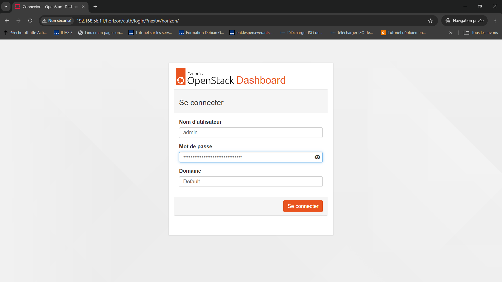

Le formulaire comporte trois champs : utilisateur, mot de passe et **Domaine**. Le champ
Domaine apparaît parce que `OPENSTACK_KEYSTONE_MULTIDOMAIN_SUPPORT = True` (guide Horizon). On
y saisit `Default`, qui correspond à `OPENSTACK_KEYSTONE_DEFAULT_DOMAIN`. L'authentification
passe par `OPENSTACK_KEYSTONE_URL = http://controller:5000/v3` (écart au guide, §8).

### 7.2 Vue de l'administrateur (`admin`, projet `admin`)

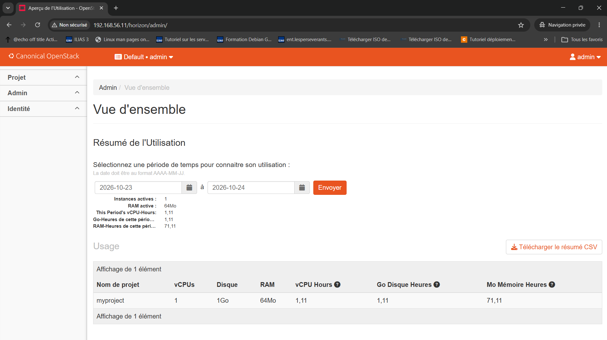

**Admin → Vue d'ensemble** agrège tous les projets. On y voit le projet `myproject` avec
1 vCPU, 1 Go de disque et 64 Mo de RAM : c'est exactement le gabarit `m1.nano` de l'instance
CirrOS. Seul un compte admin a accès à ce panneau.

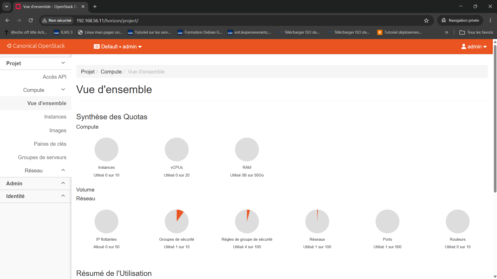

**Projet → Vue d'ensemble**, pour le projet `admin` lui-même. Les compteurs Instances,
vCPUs, RAM, IP flottantes et Routeurs sont tous à **0**, parce que l'instance et le routeur
ont été créés dans `myproject` en tant que `myuser`, comme le demande le guide. Le réseau
utilisé (1 sur 100) est `provider`, créé par admin. La section « Volume » est vide : la capture
date d'avant l'étape Cinder.

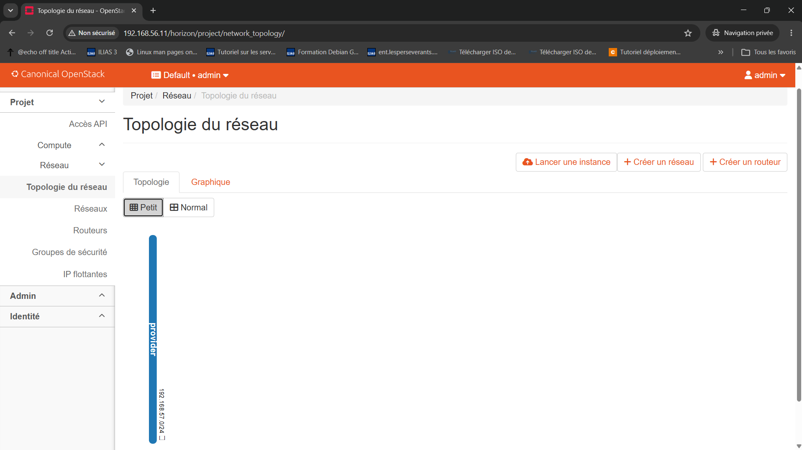

Depuis le projet `admin`, la topologie ne montre que `provider` (192.168.57.0/24). Ce réseau
a été créé par admin avec `--share --external`. Le réseau `selfservice`, le routeur et
l'instance appartiennent à `myproject` et n'apparaissent pas dans ce projet.

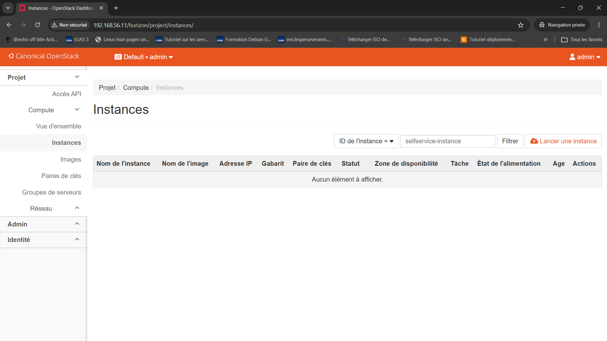

Le filtre `selfservice-instance` ne renvoie « Aucun élément à afficher » : **Projet → Instances**
ne liste que les instances du projet courant. Pour voir toutes les instances, un admin passe
par **Admin → Compute → Instances**.

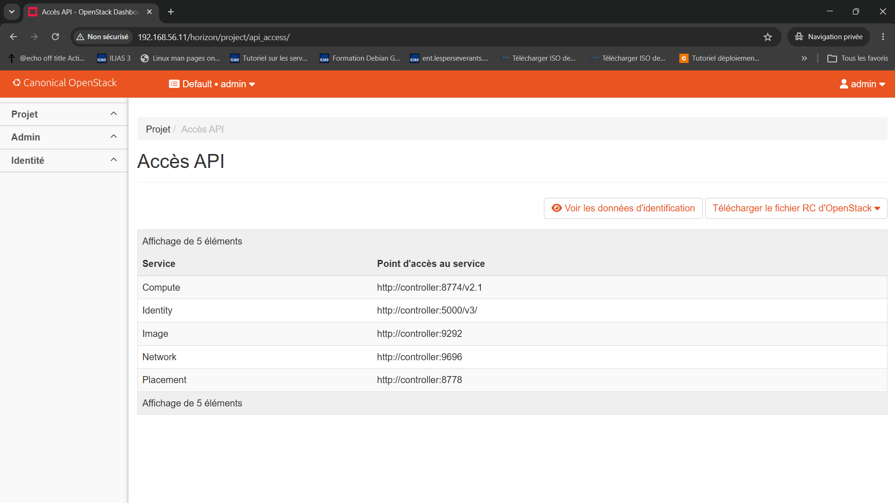

**Accès API** affiche le catalogue Keystone tel que l'utilisateur le voit. Avant l'étape
Cinder, il contient **5 services** : Compute (8774/v2.1), Identity (5000/v3/), Image (9292),
Network (9696) et Placement (8778). C'est la même chose que `openstack catalog list`.

### 7.3 Vue de l'utilisateur de démonstration (`myuser`, projet `myproject`)

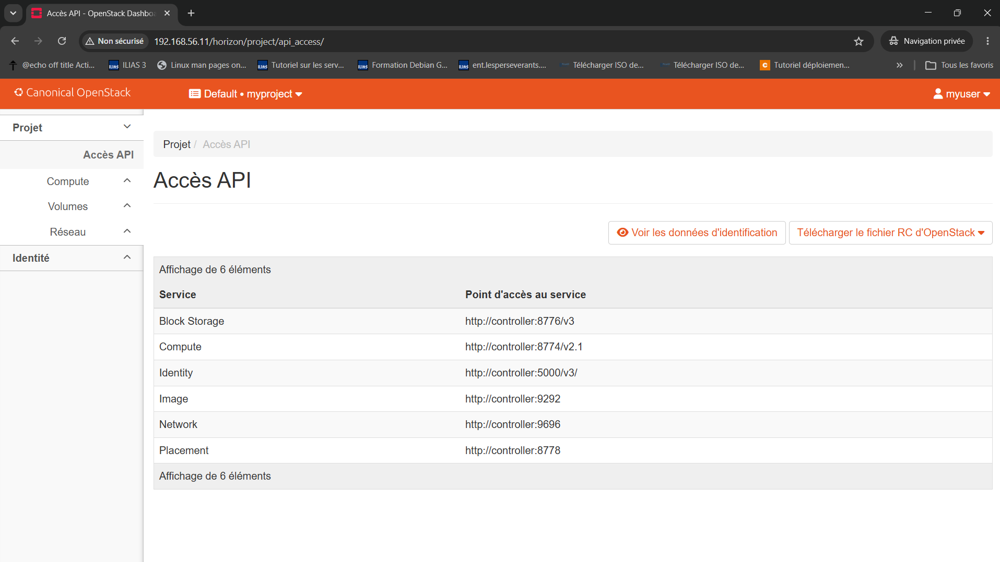

Après l'étape Cinder, le catalogue compte **6 services** : **Block Storage**
(`http://controller:8776/v3`) s'ajoute aux 5 précédents. Toutes les URL utilisent le nom
`controller`, comme les endpoints créés par les rôles Ansible.

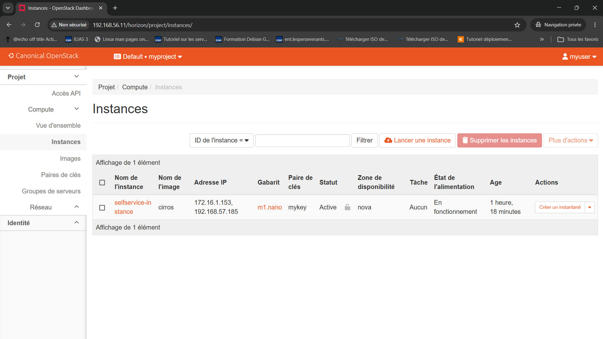
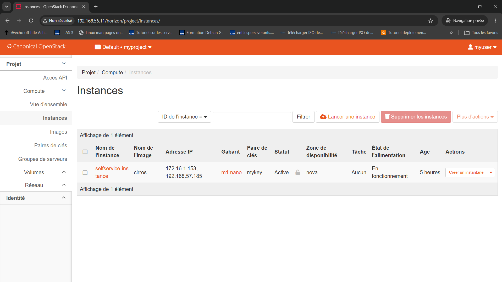

L'instance `selfservice-instance` est **Active / En fonctionnement**, avec l'image `cirros`,
le gabarit `m1.nano` et la paire de clés `mykey`. Elle a deux adresses : **172.16.1.153**
(fixe, réseau `selfservice`) et **192.168.57.185** (IP flottante). Les deux captures sont
prises à environ 4 h d'écart (âge de 1 h 18 puis de 5 h), et l'instance est restée stable
entre les deux, pendant l'installation de Cinder.

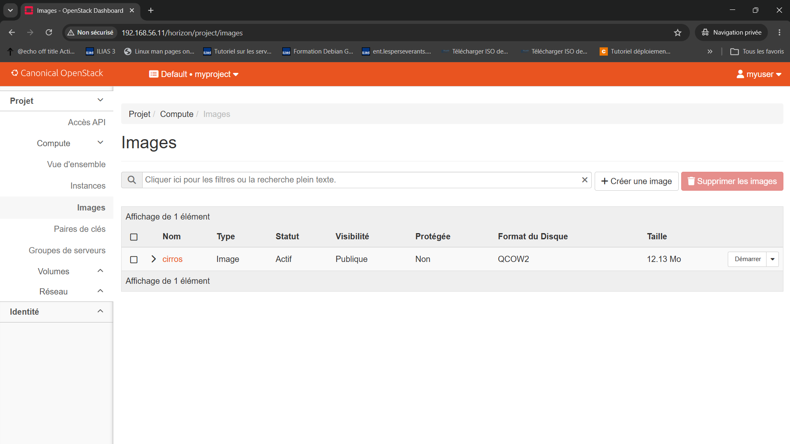

Il y a une seule image, `cirros` : **Actif**, visibilité **Publique** (`--public`, donc
utilisable par tous les projets), format **QCOW2**, 12,13 Mo (CirrOS 0.4.0). Elle est stockée
par Glance dans le backend `fs`, sous `/var/lib/glance/images/`.

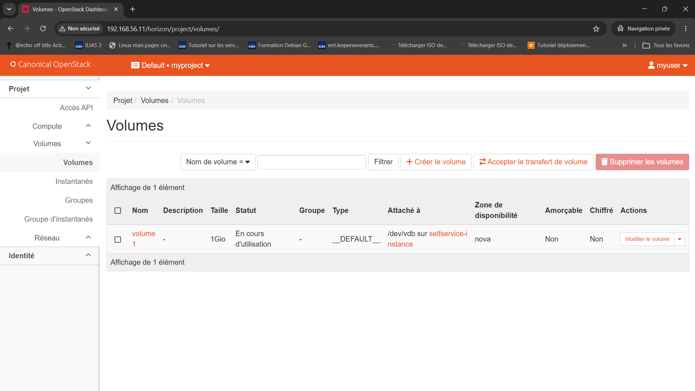

`volume1` fait **1 Gio**, il est **En cours d'utilisation** et **attaché sur /dev/vdb** à
`selfservice-instance`. Son type est `__DEFAULT__`, le type de volume par défaut créé par
Cinder, aucun type n'ayant été défini pendant le lab. C'est la vue Horizon des tests CIN-09 à
CIN-11.

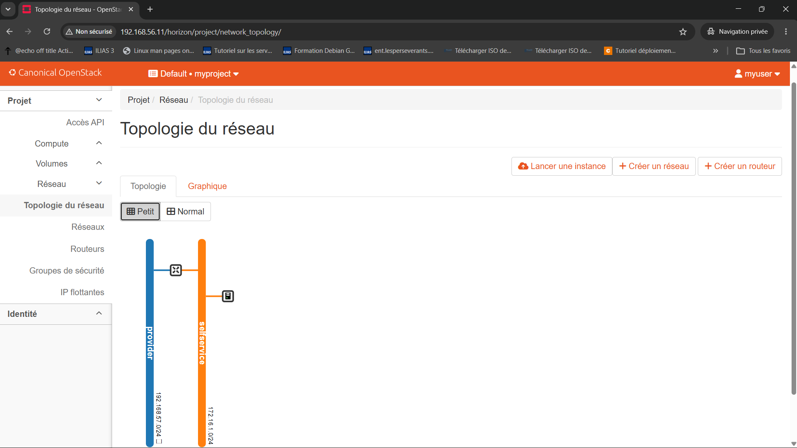

La topologie est celle de l'option 2 du guide : réseau `provider` (bleu, 192.168.57.0/24),
**routeur** au milieu, réseau `selfservice` (orange, 172.16.1.0/24) et l'**instance**
raccordée à `selfservice`. Le trafic de l'instance vers l'extérieur traverse le routeur :
NAT et IP flottante sont gérés dans le namespace `qrouter` de l'agent L3 sur le controller.

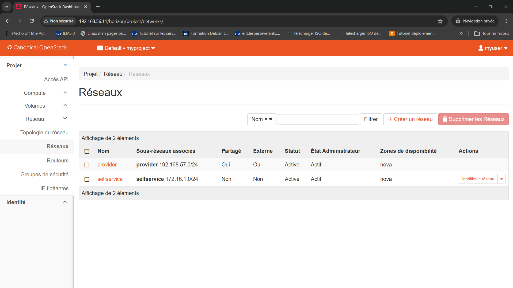

| Réseau | Sous-réseau | Partagé | Externe | Lecture |
|---|---|---|---|---|
| `provider` | 192.168.57.0/24 | Oui | Oui | réseau flat créé par admin (`--share --external`), visible de tous les projets, il porte les IP flottantes |
| `selfservice` | 172.16.1.0/24 | Non | Non | réseau VXLAN privé du projet, seul `myproject` le voit |

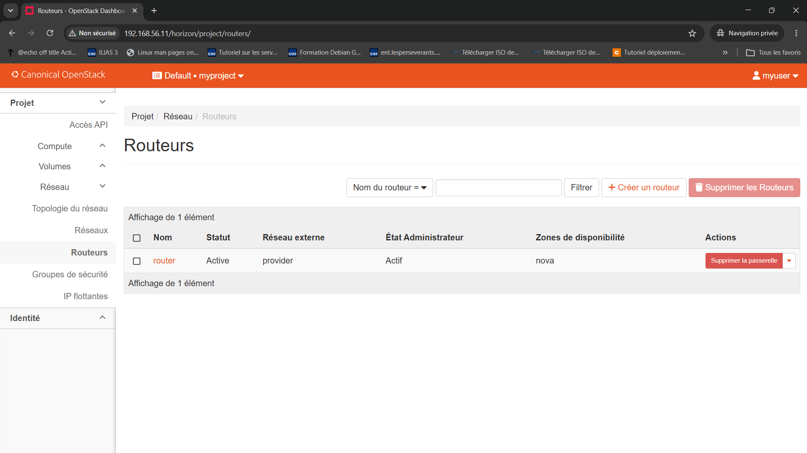

`router` est **Active**, avec `provider` comme **réseau externe** : c'est le résultat de
`openstack router set router --external-gateway provider`. Le bouton « Supprimer la
passerelle » retirerait cette passerelle externe et couperait l'accès aux IP flottantes.

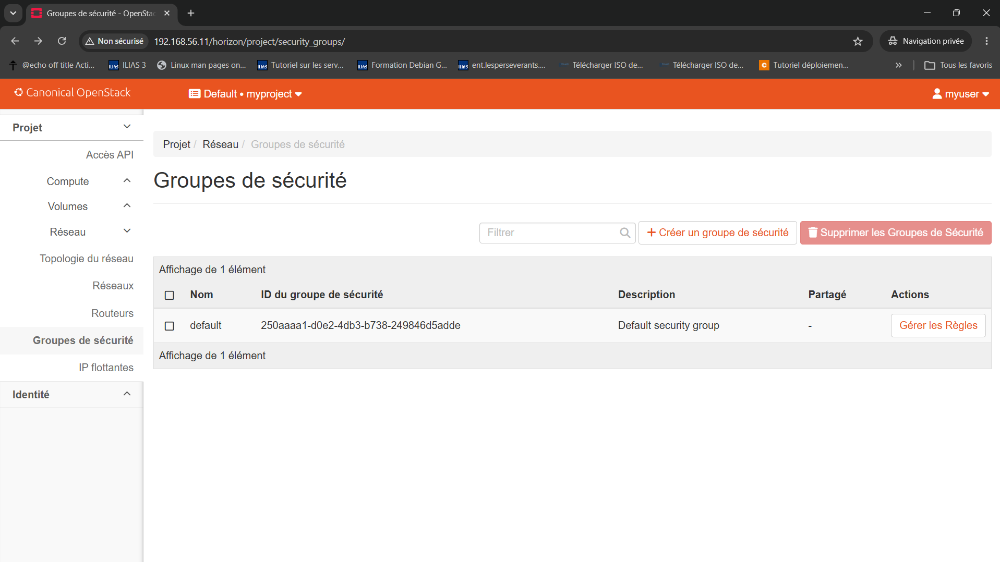
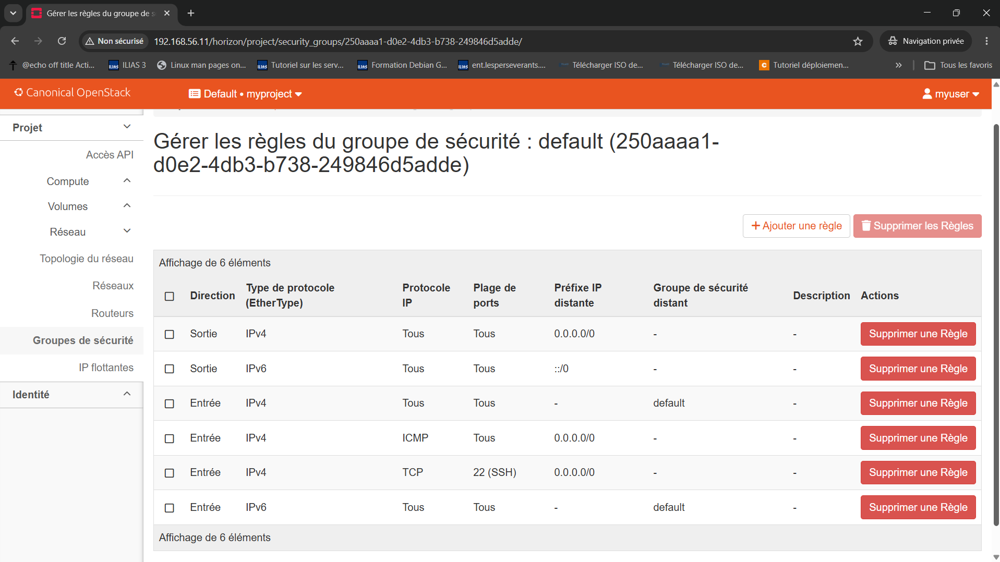

Le projet n'a qu'un groupe, `default`, avec **6 règles** :

| Règle | Origine |
|---|---|
| Sortie IPv4 et IPv6 vers tout | règles créées par Neutron avec le groupe `default` |
| Entrée IPv4 et IPv6 depuis le groupe `default` | règles créées par Neutron : les membres du groupe communiquent entre eux |
| Entrée **ICMP** depuis 0.0.0.0/0 | `openstack security group rule create --proto icmp default` (guide) |
| Entrée **TCP 22 (SSH)** depuis 0.0.0.0/0 | `openstack security group rule create --proto tcp --dst-port 22 default` (guide) |

Sans les deux dernières règles, les tests de ping et de SSH vers l'IP flottante échoueraient.
Le filtrage est appliqué par l'agent OVS sur compute1 (`firewall_driver = openvswitch`).

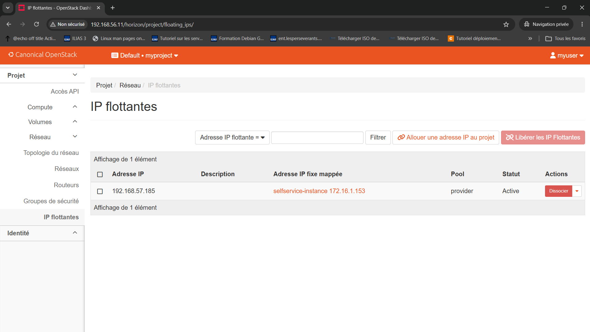

**192.168.57.185** est allouée dans le pool `provider`, mappée sur `selfservice-instance`
172.16.1.153, avec le statut **Active**. Le DNAT/SNAT correspondant est réalisé par le routeur.

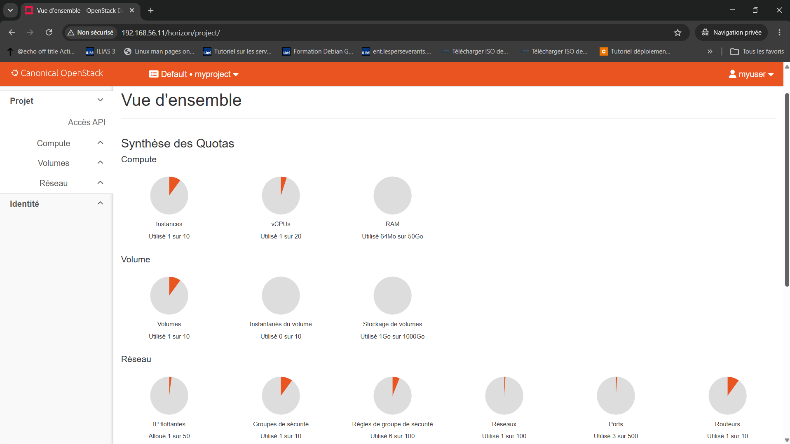

Synthèse des quotas par défaut du projet. Consommation observée :

- **Compute** : 1 instance sur 10, 1 vCPU sur 20, 64 Mo de RAM sur 50 Go ;
- **Volume** : 1 volume sur 10, 1 Go sur 1000 Go, 0 instantané ;
- **Réseau** : 1 IP flottante sur 50, 1 groupe de sécurité sur 10, 6 règles sur 100 (les 6 règles
  ci-dessus), 1 réseau sur 100 (`selfservice`, le seul qui appartient au projet), 3 ports sur
  500, 1 routeur sur 10.

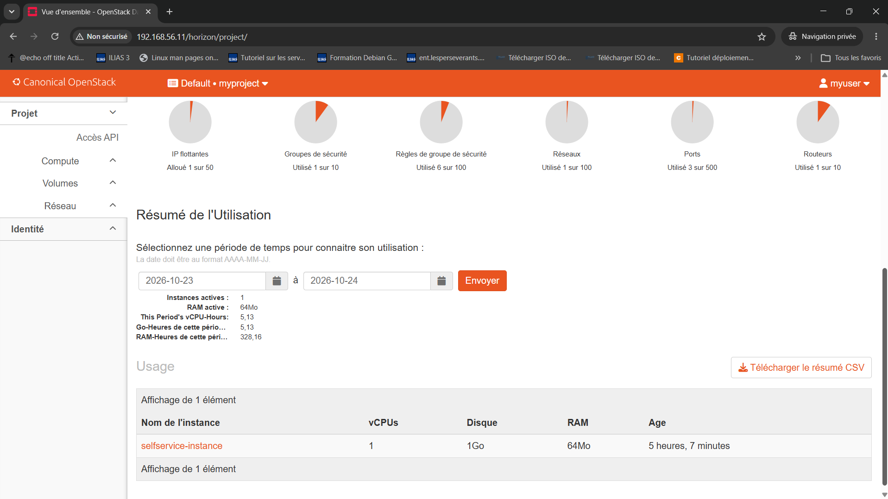

Le résumé d'utilisation sur la période du 2026-10-23 au 2026-10-24 donne 1 instance active,
64 Mo de RAM active et environ 5,13 vCPU-heures. Ce chiffre est cohérent avec 1 vCPU allumé
depuis environ 5 h. Le résumé peut être exporté en CSV.

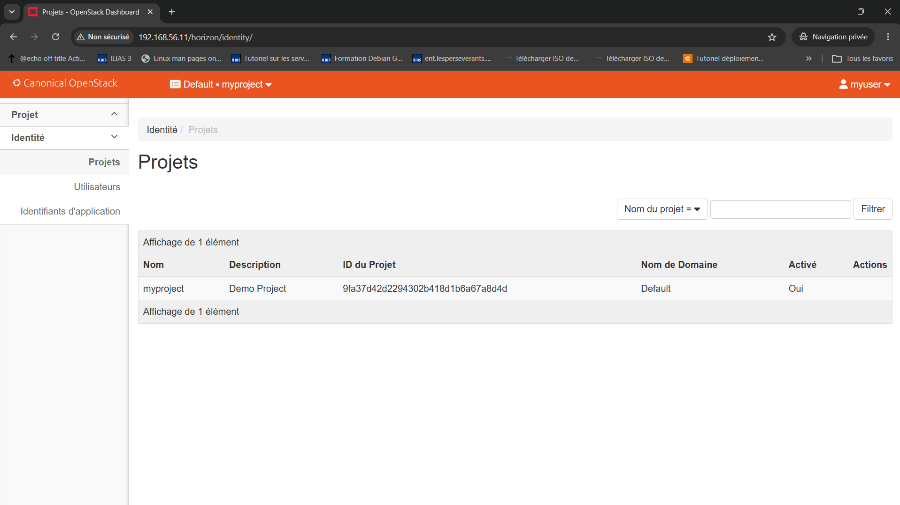
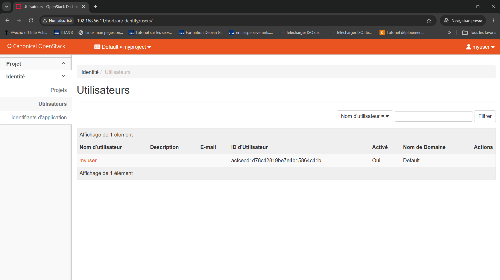

Pour `myuser`, qui n'est pas admin, **Identité → Projets** ne montre que `myproject`
(description « Demo Project », domaine `Default`), et **Identité → Utilisateurs** ne montre
que son propre compte. Les comptes de service (`glance`, `nova`, `neutron`, `cinder`…) et
`admin` ne lui sont pas visibles. C'est le cloisonnement attendu d'un utilisateur qui n'a que
les rôles `member` et `myrole` sur son projet.

---

## 8. Écarts au guide et particularités constatées

Chaque écart a été **constaté** sur le déploiement, pas supposé. Le test correspondant est
référencé dans `tests-de-validation.md`.

| Sujet | Guide | Ce dépôt | Raison |
|---|---|---|---|
| Dépôt Cloud Archive | `add-apt-repository cloud-archive:gazpacho` | `software-properties-common` passé en `state: latest` avant l'ajout | La version de la box (0.99.49.3) répondait `not a valid cloud-archive: 'gazpacho'`. Gazpacho est connu à partir de 0.99.49.4. |
| `/etc/hosts` | le nom d'hôte doit résoudre vers l'IP de management | suppression des lignes `127.0.1.1` et `127.0.2.1`, provisioner rejoué à chaque `up` | Vagrant ajoute `127.0.2.1 <hostname>` : `controller` résolvait sur la boucle locale (RabbitMQ `rabbit@controller`, bind des services). |
| memcached | remplacer `-l 127.0.0.1` par l'IP de management | suppression de **toutes** les autres lignes `-l` | `lineinfile` ne remplace que la dernière occurrence, donc memcached écoutait encore sur 127.0.0.1. |
| RabbitMQ | création de l'utilisateur `openstack` | utilisateur `guest` supprimé en plus | Recommandation de la documentation RabbitMQ (Access Control). |
| MariaDB | `mysql_secure_installation` (interactif) | équivalent non interactif via `ansible.mariadb` : comptes anonymes, `root@%` et base `test` supprimés ; root reste en `unix_socket` | Automatisation. La collection `community.mysql` signalait des dépréciations. |
| Secure RBAC | le guide crée `myrole` pour `myuser` | rôle `member` ajouté à `myuser` sur `myproject` | `enforce_new_defaults` est actif par défaut : sans `member`, `openstack network create` renvoyait **403**. |
| Mot de passe démo | – | `update_password: on_create`. Pour faire tourner le mot de passe : `-e demo_update_password=always` | Sinon la tâche était `changed` à chaque passage (non idempotente). |
| Nova `[service_user] auth_url` | `https://controller/identity` | `http://controller:5000/` | Keystone écoute sur `:5000` sans préfixe `/identity` ni TLS dans ce déploiement (catalogue `http://controller:5000/v3/`). |
| Horizon `OPENSTACK_KEYSTONE_URL` | exemple en `/identity` | `http://%s:5000/v3` | Même raison. Le guide demande d'inclure le port dans ce cas. |
| API servies par Apache | `service nova-api restart` | les handlers redémarrent **apache2** | Paquets Ubuntu : nova-api (8774), nova-api-metadata (8775), neutron API (9696), placement (8778) et cinder-api (8776) sont servis par Apache mod_wsgi (constaté avec `ss -tlnp`). Aucun service systemd `nova-api` n'existe. |
| nova-api-metadata | – | paquet `nova-api-metadata` installé sur le controller | Nécessaire pour que l'agent de métadonnées Neutron joigne le port 8775. |
| Unités Neutron | `neutron-server` | unités découvertes avec `service_facts` : `neutron-rpc-server`, `neutron-periodic-workers` et les agents | Découpage des unités constaté dans le paquet Ubuntu 2026.1. |
| Interface provider | « configurer l'interface sans IP » | template netplan `/etc/netplan/60-provider.yaml` (sans DHCP, sans RA, `optional: true`) + bridge OVS `br-provider` créé par `ovs-vsctl` | Persistance de la configuration après redémarrage. |
| Accès SSH à CirrOS 0.4.0 | `ssh cirros@IP` | `ssh -o PubkeyAcceptedAlgorithms=+ssh-rsa cirros@IP` | OpenSSH ≥ 8.8 refuse les signatures `ssh-rsa` (SHA-1) que propose CirrOS 0.4.0, d'où la demande de mot de passe. Les métadonnées, elles, étaient correctes (haproxy 200 sur `public-keys`). |
| Filtre LVM | `a/sdb/` (+ `a/sda/` si l'OS est sur LVM) | cas « OS sur LVM » appliqué sur block1 **et** compute1 | La box bento a l'OS sur LVM (`ubuntu-vg` sur `sda3`), et `use_devicesfile=0` (le filtre regex s'applique). |
| tgt | créer `/etc/tgt/conf.d/cinder.conf` | créé seulement si aucune inclusion `/var/lib/cinder/volumes/` n'existe | Évite une double déclaration des cibles. Constaté : le paquet Ubuntu n'en fournit pas. |
| VG `cinder-volumes` « plein » | – | normal : thin pool `cinder-volumes-pool` | `lvm_type` vaut `auto` par défaut (« Auto defaults to thin if thin is supported »), et `thin-provisioning-tools` est installé. `vgs` montre alors très peu de `VFree`. |
| `boot_timeout = 600` | – | dans le Vagrantfile | Marge utile si l'hyperviseur Windows est actif (mode NEM, démarrages très lents). Sans effet quand il est désactivé. |
| `box_architecture = "amd64"` | – | dans le Vagrantfile | La détection automatique ne trouvait pas la box amd64 ajoutée localement (« box doesn't support provider »). |

Hors guide, non appliqué : la partie optionnelle de Glance sur les quotas par projet
(*registered limits*, `use_keystone_limits`).

---

## 9. Limites (laboratoire, pas production)

Ce TP suit le guide d'installation, qui privilégie la simplicité :

- **pas de TLS** : API, Horizon, RabbitMQ (5672), MariaDB et iSCSI circulent en clair sur le réseau de management ;
- **RabbitMQ** écoute sur toutes les interfaces : la configuration par défaut n'est pas restreinte au management ;
- **un seul controller**, sans haute disponibilité (MariaDB, RabbitMQ et les API sont des points de défaillance uniques) ;
- **tgt** : la cible iSCSI montre une ACL `ALL`, avec un compte d'authentification généré par Cinder (`Account information`) ;
- les secrets sont protégés par Ansible Vault, mais ils restent en clair dans les fichiers de configuration des services (0640, groupe du service), comme dans toute installation par paquets.

---

## 10. Références officielles

- Guide d'installation OpenStack (environnement, NTP, paquets, SQL, RabbitMQ, memcached, etcd) : https://docs.openstack.org/install-guide/
- Ubuntu Cloud Archive : https://wiki.ubuntu.com/OpenStack/CloudArchive
- Keystone 2026.1 : https://docs.openstack.org/keystone/2026.1/install/
- Glance 2026.1 : https://docs.openstack.org/glance/2026.1/install/
- Placement 2026.1 : https://docs.openstack.org/placement/2026.1/install/
- Nova 2026.1 : https://docs.openstack.org/nova/2026.1/install/
- Neutron 2026.1 : https://docs.openstack.org/neutron/2026.1/install/
- Horizon 2026.1 : https://docs.openstack.org/horizon/2026.1/install/
- Cinder 2026.1 (controller) : https://docs.openstack.org/cinder/2026.1/install/cinder-controller-install-ubuntu.html
- Cinder 2026.1 (nœud de stockage) : https://docs.openstack.org/cinder/2026.1/install/cinder-storage-install-ubuntu.html
- Cinder, pilote LVM (`lvm_type`) : https://docs.openstack.org/cinder/2026.1/configuration/block-storage/drivers/lvm-volume-driver.html
- Lancer une instance : https://docs.openstack.org/install-guide/launch-instance.html
- Vagrant, disques : https://developer.hashicorp.com/vagrant/docs/disks/usage
