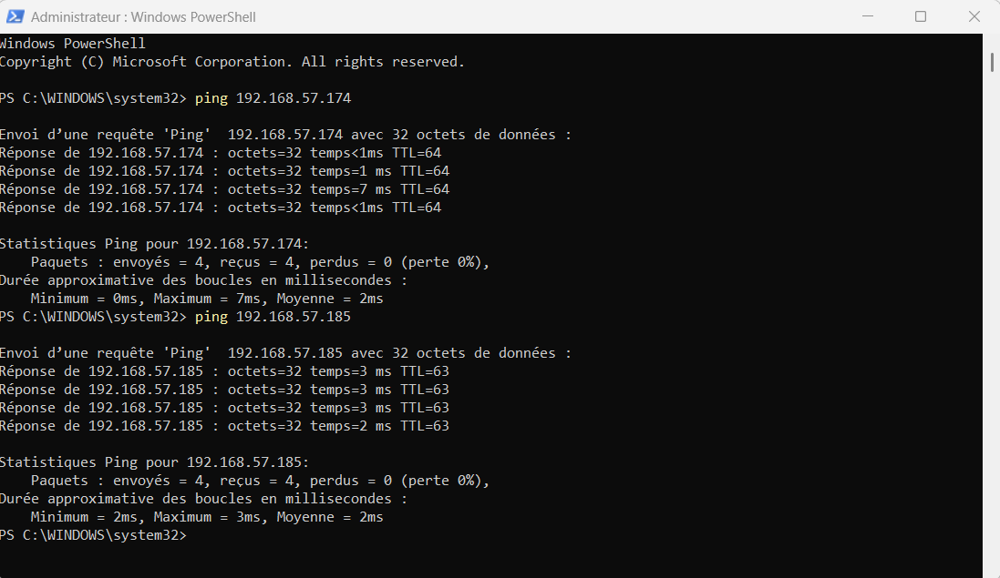
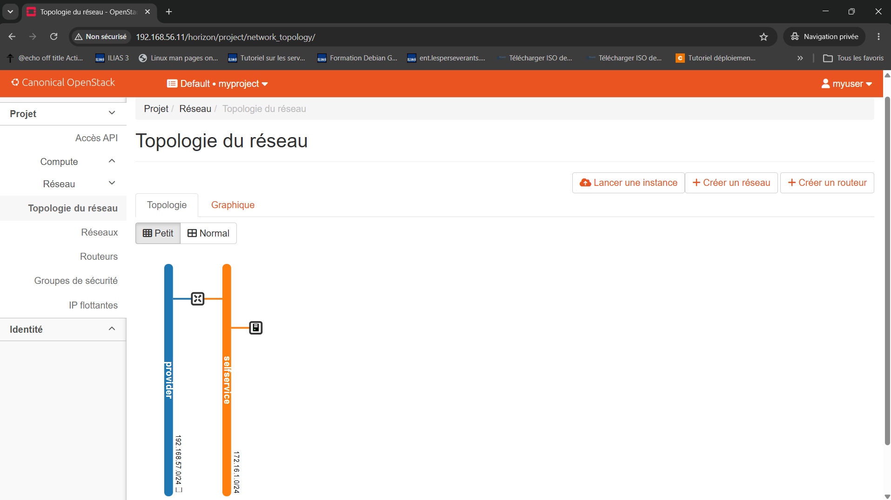
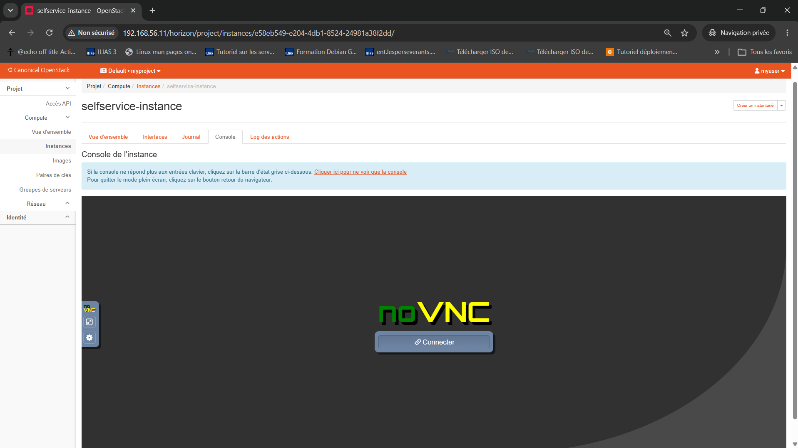
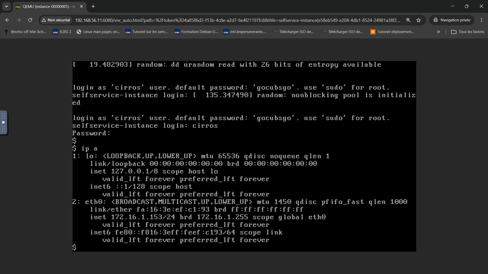
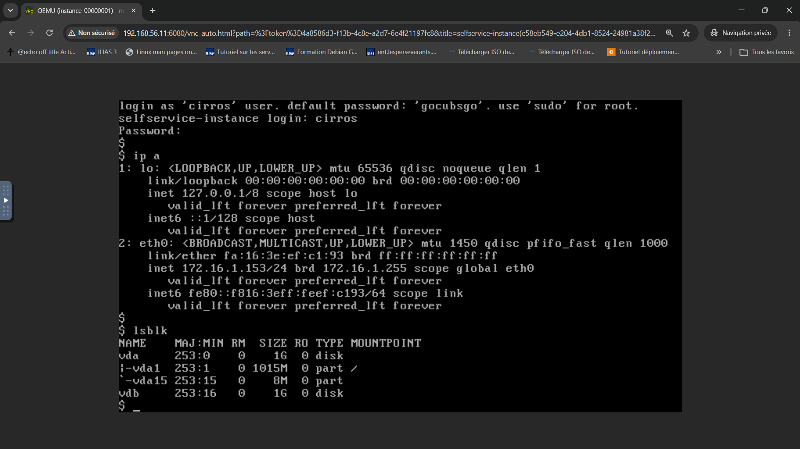

# Tests de validation – TP1 OpenStack 2026.1 (Gazpacho)

Chaque étape a été validée **manuellement** avant de passer à la suivante. Les commandes se
lancent une par ligne, depuis le nœud indiqué.

- **CLI admin** : `vagrant ssh controller`, puis `source ~/admin-openrc`.
- **CLI démo** : `vagrant ssh controller`, puis `source ~/demo-openrc` (projet `myproject`, utilisateur `myuser`).

Les tests sont identifiés par étape : ENV, INF, KS, GL, PL, NO, NE, INST, HZ, CIN et IDEM.
Les valeurs de la colonne « Constaté » sont celles relevées sur le déploiement de référence.
Les captures d'écran sont dans `docs/captures/`. Celles qui servent de preuve suivent le tableau
de leur étape, et la visite complète d'Horizon est dans le README (§7).

---

## ENV – VM et environnement commun

| ID | Nœud | Commande | Attendu | Constaté |
|---|---|---|---|---|
| ENV-01 | Windows | `vagrant status` | `controller`, `compute1` et `block1` en `running` | ✅ |
| ENV-02 | Windows | `Get-CimInstance -Namespace root\Microsoft\Windows\DeviceGuard -ClassName Win32_DeviceGuard \| Select VirtualizationBasedSecurityStatus` | `0` (hyperviseur Windows désactivé) | ✅ 0 (2 avant `bcdedit`) |
| ENV-03 | tous | `getent hosts controller compute1 block1` | 192.168.56.11 / .31 / .41, aucune ligne en 127.0.x.1 | ✅ |
| ENV-04 | controller | `chronyc sources` | une source amont marquée `^*` | ✅ |
| ENV-05 | compute1, block1 | `chronyc sources` | `^* controller` | ✅ |
| ENV-06 | tous | `apt-cache policy python3-openstackclient` | origine `ubuntu-cloud.archive.canonical.com noble-updates/gazpacho` | ✅ |
| ENV-07 | compute1 | `ls -l /dev/kvm; egrep -c '(vmx\|svm)' /proc/cpuinfo` | `/dev/kvm` présent, compteur > 0 | ✅ |

## INF – Services d'infrastructure (controller)

| ID | Nœud | Commande | Attendu | Constaté |
|---|---|---|---|---|
| INF-01 | controller | `sudo ss -tlnp \| grep -E ':3306\|:11211\|:2379\|:5672'` | MariaDB et memcached sur 192.168.56.11, etcd sur 192.168.56.11:2379, RabbitMQ sur 5672 | ✅ |
| INF-02 | controller | `sudo mysql -e 'SELECT user,host FROM mysql.user'` | aucun utilisateur anonyme, pas de `root@%` | ✅ |
| INF-03 | controller | `sudo rabbitmqctl list_users` | `openstack` seul (`guest` supprimé) | ✅ |
| INF-04 | controller | `grep '^-l' /etc/memcached.conf` | une seule ligne : `-l 192.168.56.11` | ✅ (corrigé : 127.0.0.1 restait au départ) |
| INF-05 | compute1 | `for p in 3306 5672 11211 2379; do nc -zv controller $p; done` | les 4 ports joignables depuis le réseau de management | ✅ |

## KS – Keystone

| ID | Nœud | Commande | Attendu | Constaté |
|---|---|---|---|---|
| KS-01 | controller (admin) | `openstack token issue` | jeton émis | ✅ |
| KS-02 | controller (démo) | `openstack token issue` | jeton émis pour `myuser` / `myproject` | ✅ |
| KS-03 | controller (admin) | `openstack endpoint list --service identity` | 3 endpoints `http://controller:5000/v3/` | ✅ |
| KS-04 | controller (admin) | `openstack role list` | `admin`, `member`, `reader`, `myrole` | ✅ |
| KS-05 | controller (admin) | `openstack role assignment list --user myuser --project myproject --names` | `myrole` **et** `member` | ✅ |
| KS-06 | controller | `sudo stat -c '%a %U:%G' /etc/keystone/keystone.conf ~/admin-openrc` | `640 root:keystone` et `600` | ✅ |

## GL – Glance

| ID | Nœud | Commande | Attendu | Constaté |
|---|---|---|---|---|
| GL-01 | controller (admin) | `openstack image list` | `cirros` (0.4.0) `active` | ✅ |
| GL-02 | controller | `sudo ls -l /var/lib/glance/images/` | un fichier nommé d'après l'ID de l'image (backend `fs`) | ✅ |

## PL – Placement

| ID | Nœud | Commande | Attendu | Constaté |
|---|---|---|---|---|
| PL-01 | controller | `sudo placement-status upgrade check` | tous les contrôles en `Success` | ✅ |
| PL-02 | controller (admin) | `openstack --os-placement-api-version 1.2 resource class list --sort-column name` | liste des classes de ressources | ✅ |

## NO – Nova

| ID | Nœud | Commande | Attendu | Constaté |
|---|---|---|---|---|
| NO-01 | controller | `sudo nova-manage cell_v2 list_cells` | `cell0` et `cell1` | ✅ |
| NO-02 | controller (admin) | `openstack compute service list` | `nova-scheduler`, `nova-conductor` (controller) et `nova-compute` (compute1) `up` | ✅ |
| NO-03 | compute1 | `grep -r virt_type /etc/nova/` | pas de `virt_type = qemu` → **KVM** | ✅ |
| NO-04 | controller (admin) | `openstack hypervisor list` | `compute1` `up` (découvert par `discover_hosts`) | ✅ |
| NO-05 | controller | `sudo nova-status upgrade check` | tous les contrôles en `Success` | ✅ |
| NO-06 | controller | `sudo ss -tlnp \| grep -E ':8774\|:8775'` | `apache2` (nova-api et nova-api-metadata servis par mod_wsgi) | ✅ |

## NE – Neutron (option 2 : self-service, OVS + VXLAN)

| ID | Nœud | Commande | Attendu | Constaté |
|---|---|---|---|---|
| NE-01 | controller (admin) | `openstack network agent list` | 5 agents `:-)` : OVS (controller), OVS (compute1), L3, DHCP, Metadata | ✅ |
| NE-02 | controller, compute1 | `sudo ovs-vsctl show` | `br-int`, `br-tun` (tunnel VXLAN vers l'autre nœud), `br-provider` avec le port `eth2` | ✅ (`br-tun` apparaît environ 20 s après le démarrage de l'agent) |
| NE-03 | controller, compute1 | `ip -br addr show eth2` | `UP`, **aucune** adresse IPv4 ni IPv6 | ✅ |
| NE-04 | controller | `sudo ss -tlnp \| grep :9696` | `apache2` | ✅ |

## INST – Lancement d'une instance (réseau self-service)

| ID | Nœud | Commande | Attendu | Constaté |
|---|---|---|---|---|
| INST-01 | controller (démo) | `openstack network list` | `provider` et `selfservice` | ✅ |
| INST-02 | controller | `ip netns` | un `qrouter-…` et deux `qdhcp-…` | ✅ |
| INST-03 | controller (admin) | `openstack port list --router router` | IP du routeur côté provider | ✅ 192.168.57.174 |
| INST-04 | Windows | `ping 192.168.57.174` | réponse, TTL 64 | ✅ |
| INST-05 | controller (démo) | `openstack server list` | `selfservice-instance` `ACTIVE` | ✅ 172.16.1.153 et 192.168.57.185 |
| INST-06 | instance | `curl http://169.254.169.254/latest/meta-data/public-keys` | la clé `mykey` est listée (chemin instance → haproxy du qrouter → agent metadata → nova-api-metadata 8775) | ✅ vérifié par les logs haproxy (requêtes en `200`, dont `public-keys`) ; la commande `curl` reste à rejouer |
| INST-07 | Windows | `ping 192.168.57.185` | réponse, TTL 63 (un saut de routage) | ✅ |
| INST-08 | poste client | `ssh -o PubkeyAcceptedAlgorithms=+ssh-rsa cirros@192.168.57.185` | connexion **par clé**, sans mot de passe | ✅ (sans l'option : mot de passe demandé, voir README §8) |
| INST-09 | instance | `/sbin/ip a; /sbin/ip r` | `eth0` 172.16.1.153/24, **MTU 1450** (VXLAN), route par défaut présente | ✅ |

### Preuves

**INST-04 et INST-07.** Les pings partent du poste Windows, qui est relié au réseau
host-only 192.168.57.0/24 :

- **192.168.57.174**, la patte `provider` du routeur, répond avec un **TTL 64**. C'est la
  valeur par défaut de Linux : le namespace `qrouter` répond directement, sans aucun routage.
- **192.168.57.185**, l'IP flottante, répond avec un **TTL 63**. La réponse vient de CirrOS
  (TTL 64 au départ), et le routeur décrémente le TTL en la réacheminant (DNAT vers
  172.16.1.153). Ce saut supplémentaire prouve que le trafic traverse bien le routeur Neutron.
- 0 % de perte dans les deux cas.

**INST-05.** `selfservice-instance` est **Active**, avec son adresse fixe 172.16.1.153 et son
IP flottante 192.168.57.185, le gabarit `m1.nano` et la paire de clés `mykey`.

**INST-01 et INST-02**, côté interface : `provider` ↔ `router` ↔ `selfservice` ↔ instance.

## HZ – Horizon

| ID | Nœud | Action | Attendu | Constaté |
|---|---|---|---|---|
| HZ-01 | navigateur Windows | http://192.168.56.11/horizon | page de connexion (domaine `Default`) | ✅ |
| HZ-02 | navigateur | connexion `admin` | tableau de bord admin | ✅ |
| HZ-03 | navigateur | connexion `myuser` → Instances / Topologie réseau | instance et topologie provider ↔ router ↔ selfservice | ✅ |
| HZ-04 | navigateur | Instance → Console (noVNC, `192.168.56.11:6080`) | invite de login CirrOS, `ip a` montre 172.16.1.153/24, MTU 1450 | ✅ |

### Preuves

**HZ-01.** La page de connexion se trouve sur `http://192.168.56.11/horizon/auth/login/`. Le
champ **Domaine** (`Default`) est présent, ce qui confirme que
`OPENSTACK_KEYSTONE_MULTIDOMAIN_SUPPORT` est pris en compte.

**HZ-02.** Connecté en `admin`, on accède au panneau **Admin → Vue d'ensemble**, qui
n'existe que pour un compte admin. Il montre l'utilisation du projet `myproject`.

**HZ-04, étape 1.** L'onglet **Console** de l'instance embarque noVNC. Le bouton
« Connecter » ouvre le WebSocket vers `nova-novncproxy` (controller, port 6080).

**HZ-04, étape 2.** L'URL `192.168.56.11:6080/vnc_auto.html?path=…token…` correspond à
`novncproxy_base_url`, et le titre de l'onglet est `QEMU (instance-00000001)`. Le chemin
complet fonctionne : navigateur → nova-novncproxy (controller) → serveur VNC de QEMU sur
compute1 (`server_listen = 0.0.0.0`, `server_proxyclient_address = $my_ip`). Dans CirrOS,
`ip a` montre `eth0` avec **172.16.1.153/24** et une **MTU de 1450**. Cette MTU vaut 1500
moins la surcharge VXLAN, et elle a été annoncée par le DHCP de Neutron.

## CIN – Cinder (LVM + iSCSI sur block1)

| ID | Nœud | Commande | Attendu | Constaté |
|---|---|---|---|---|
| CIN-01 | Windows | `vagrant up block1` | « Disk 'cinder-volumes' … Creating and attaching », sans avertissement *experimental* | ✅ Vagrant 2.4.9 |
| CIN-02 | block1 | `lsblk; sudo lvmconfig --typeconfig full devices/use_devicesfile` | `sdb` vide de 20 Go ; `use_devicesfile=0` | ✅ (OS sur LVM : `ubuntu-vg` / `sda3`) |
| CIN-03 | controller (admin) | `openstack endpoint list --service block-storage` | 3 endpoints `http://controller:8776/v3` | ✅ |
| CIN-04 | controller | `sudo ss -tlnp \| grep 8776` | `apache2` | ✅ |
| CIN-05 | controller (admin) | `openstack volume service list` | `cinder-scheduler` (controller) et `cinder-volume` (`block1@lvm`) `up` | ✅ |
| CIN-06 | block1 | `sudo vgs` | `cinder-volumes` (≈20 Go) **et** `ubuntu-vg` visibles | ✅ |
| CIN-07 | block1 | `sudo lvmconfig devices/filter; ls /etc/tgt/conf.d/` | `["a/sda/","a/sdb/","r/.*/"]`, un seul `cinder.conf` | ✅ |
| CIN-08 | compute1 | `sudo lvmconfig devices/filter; sudo vgs` | `["a/sda/","r/.*/"]`, `ubuntu-vg` visible | ✅ |
| CIN-09 | controller (démo) | `openstack volume create --size 1 volume1` puis `openstack volume list` | `available` | ✅ |
| CIN-10 | block1 | `sudo lvs -a cinder-volumes` | thin pool `cinder-volumes-pool` (`twi-`) et `volume-<id>` 1 Go (`Vwi-`) | ✅ pool de 19 Go |
| CIN-11 | controller (démo) | `openstack server add volume selfservice-instance volume1` puis `openstack volume list` | `in-use`, « Attached to selfservice-instance on /dev/vdb » | ✅ |
| CIN-12 | block1 | `sudo tgtadm --lld iscsi --mode target --op show` | cible `iqn.2010-10.org.openstack:volume-<id>` `ready`, initiateur 192.168.56.31 | ✅ |
| CIN-13 | compute1 | `sudo iscsiadm -m session` | session vers `192.168.56.41:3260` | ✅ |
| CIN-14 | instance | `lsblk` | `vdb` de 1G | ✅ |

### Preuves

**CIN-14.** Dans la même console noVNC, après `openstack server add volume`, `lsblk` montre
deux disques :

- `vda`, 1G : le disque racine du gabarit `m1.nano`, avec les partitions `vda1` (`/`) et `vda15` ;
- **`vdb`, 1G** : le volume Cinder `volume1`, qui n'est pas partitionné.

Le volume a suivi tout le chemin : LV fin `volume-…` sur block1 → cible iSCSI tgt → session
`iscsiadm` sur compute1 → disque virtio présenté par libvirt à l'instance.

**CIN-11**, côté Horizon : `volume1` est **En cours d'utilisation**, « /dev/vdb sur
selfservice-instance ».

**CIN-03**, côté Horizon : le service **Block Storage** (`http://controller:8776/v3`) est
apparu dans le catalogue. Avant Cinder, il y avait 5 services (capture 15 du README) ; il y
en a maintenant 6.

## IDEM – Idempotence

| ID | Nœud | Commande | Attendu | Constaté |
|---|---|---|---|---|
| IDEM-01 | Windows | `vagrant provision controller --provision-with ansible` | `changed=0 failed=0` | ✅ ok=128 changed=0 |
| IDEM-02 | Windows | `vagrant provision compute1 --provision-with ansible` | `changed=0 failed=0` | ✅ ok=28 changed=0 |
| IDEM-03 | Windows | `vagrant provision block1 --provision-with ansible` | `changed=0 failed=0` | ✅ ok=20 changed=0 |

---

## Problèmes rencontrés et diagnostic

| Symptôme | Diagnostic | Correction |
|---|---|---|
| `vagrant up` : box doesn't support provider | détection d'architecture `:auto` | `config.vm.box_architecture = "amd64"` |
| démarrages en timeout, VM figée environ 20 min | `VBox.log` : `fall back to NEM: VT-x is not available` (VBS = 2) | `bcdedit /set "{current}" hypervisorlaunchtype off` puis redémarrage |
| `controller` résout en 127.0.2.1 | ligne ajoutée par Vagrant dans `/etc/hosts` | `sed` dans le provisioner `hosts` (`run: always`) |
| `not a valid cloud-archive: 'gazpacho'` | software-properties-common 0.99.49.3 | `state: latest` (0.99.49.4) |
| memcached encore sur 127.0.0.1 | plusieurs lignes `-l`, `lineinfile` ne traite que la dernière | tâche de suppression des autres lignes `-l` |
| `Could not find the requested service nova-api` | nova-api servi par Apache | handler sur `apache2` ; redémarrage manuel, car un échec de tâche annule les handlers en attente |
| `nova-api-metadata` introuvable | également servi par Apache | handler `apache2` uniquement |
| 403 sur `network create` (myuser) | Secure RBAC : `member` requis | `role_assignment member` dans le rôle keystone |
| SSH CirrOS : mot de passe demandé | métadonnées correctes (haproxy 200) ; OpenSSH refuse `ssh-rsa` (SHA-1) | `-o PubkeyAcceptedAlgorithms=+ssh-rsa` |
| `ip: not found` en SSH sur CirrOS | `ip` est dans `/sbin`, absent du `PATH` de la session SSH | `/sbin/ip` |
